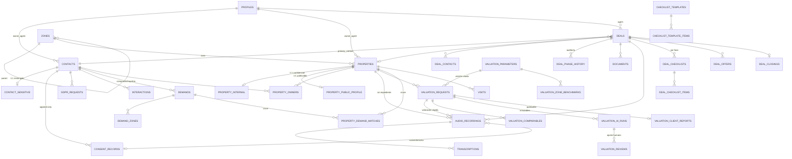
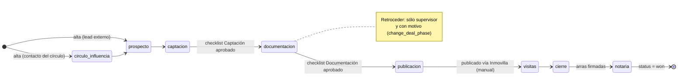

# CRM Inmobiliario RK Santos: arquitectura funcional y de datos

**Cliente:** RK Santos (Raúl Santos) · **Consultora:** Solfico · **Versión:** 1.1 (final) · 17/11/2026
**Stack:** Supabase (PostgreSQL 15+, Auth, Storage privado con RLS) · Next.js App Router · TypeScript estricto · Vercel AI SDK 6 + Zod 4

Los nombres de dominio están en el [glosario](../00-inicio/glosario.md). Este archivo es el contrato de tablas. El borrador del turno 1 no forma parte del contrato.

| Archivo | Contenido |
|---|---|
| `supabase/migrations/20261117000000_init_schema.sql` | Migración única y ejecutable: enums, 36 tablas, triggers, helpers, RLS, buckets y políticas de Storage, cruce |
| `src/lib/validations/schema.types.ts` | Esquemas Zod de dominio y salida estructurada del Valorador IA |
| `supabase/seed/seed.sql` | Datos iniciales idempotentes: zonas de Barcelona y Vilanova i la Geltrú, parámetros del valorador v1 activos, benchmarks de **EJEMPLO** y plantilla de checklist de **EJEMPLO** (inactiva) |
| `00_supabase_stubs.sql` | **Sólo para pruebas locales, no va al repositorio de migraciones**: simula `auth` y `storage` de Supabase. No está en el repo. |
| `supabase/tests/rls_smoke_test.sql` | Prueba de humo para una BD desechable: 80 comprobaciones de RLS, pipeline, checklists, valorador (incluido el bloqueo del informe al cliente), audios (incluida la vinculación posterior a un expediente), storage, cruce y RGPD |

---

## Cambios en v1.1 (final)

- **Bloqueo duro del informe al cliente:** trigger `guard_valuation_client_report` y `protect_reported_review` (§9).
- **Provincia por defecto:** `'Barcelona'` en zonas, inmuebles y Zod.
- **Audios sin expediente:** el audio se vincula a expediente, inmueble y/o valoración, con rutas `deal/`, `property/` o `valuation/` (§6).
- **Vinculación posterior a un expediente sin mover el archivo:** lectura por cualquier vínculo y resolución por fila en Storage (§6, "Decisión v1.1").
- **`seed.sql`:** zonas de Barcelona y Vilanova i la Geltrú, parámetros v1 activos, benchmarks y checklist de **EJEMPLO**.
- **Cruce por cualquier ancestro de zona** (`private.zone_lineage`).
- **`valuation_zone_benchmarks.is_placeholder`.**
- **`valuation_parameters.created_by` opcional,** para la versión de sistema.

---

## 1. Principios de diseño

1. **Database-first.** El esquema completo del CRM existe desde el día 1. La Fase 1 sólo *opera* Core + Valorador IA; las tablas de fases posteriores ya existen, tienen RLS y están vacías. Así no hay migraciones destructivas al crecer.
2. **La base de datos es la última línea de defensa.** Las reglas de negocio críticas (fases, aprobaciones, inmutabilidad, umbrales) se imponen en Postgres con triggers y RLS, no sólo en la UI. La app Next.js valida con Zod para dar una buena experiencia, y la BD vuelve a validar.
3. **Separación física de datos:** publicable ↔ interno ↔ sensible (`properties` / `property_public_profile` / `property_internal`, `contacts` / `contact_sensitive`).
4. **Seguridad Supabase:**
   - RLS en las 36 tablas de `public`.
   - Las funciones `SECURITY DEFINER` viven sólo en el esquema `private`, que la Data API no expone, con `search_path = ''`.
   - Las políticas usan el patrón `(select fn())`, que se cachea como initPlan.
   - Los roles viven en `profiles`, **nunca** en `user_metadata`.
   - `anon` no tiene ningún privilegio.
5. **Inmovilla es una caja negra externa.** No hay scraping ni publicación directa (ver §10).
6. **Zona de operación: Barcelona.** `zones.province` y `properties.province` tienen por defecto `'Barcelona'`, igual que en Zod. Los datos de prueba usan zonas del Eixample.
7. **Nunca hay informe al cliente sin validación humana completa.** Es un bloqueo duro en BD (§9).

---

## 2. Módulos y alcance por fase

| Módulo | Tablas | Fase |
|---|---|---|
| **Identidad y roles** | `profiles` | **F1** |
| **Zonificación** | `zones` | **F1** |
| **Contactos** | `contacts`, `contact_sensitive` | **F1** |
| **RGPD** | `consent_records`, `gdpr_requests`, `audit_log`, vista `v_gdpr_retention_due` | **F1** |
| **Inmuebles: ficha técnica** | `properties`, `property_internal`, `property_owners` | **F1** |
| **Inmuebles: perfil publicable** | `property_public_profile` | F2 |
| **Expedientes / pipeline** | `deals`, `deal_contacts`, `deal_phase_history`, vista `v_pipeline_summary` | **F1** |
| **Documentos (Storage)** | `documents` + 5 buckets privados | **F1** |
| **Seguimiento de clientes** | `interactions`, `tasks` | **F1** |
| **Audio y transcripción** | `audio_recordings`, `transcriptions` | **F1** |
| **Valorador IA** | `valuation_parameters`, `valuation_zone_benchmarks`, `valuation_requests`, `valuation_comparables`, `valuation_ai_runs`, `valuation_reviews`, `valuation_client_reports` | **F1** |
| **Demandas y cruce** | `demands`, `demand_zones`, `property_demand_matches`, funciones `match_*` | F2 |
| **Visitas** | `visits` | F2 |
| **Checklists de franquicia** | `checklist_templates`, `checklist_template_items`, `deal_checklists`, `deal_checklist_items`, vista `v_review_queue` | F2 |
| **Cierre y notaría** | `deal_offers`, `deal_closings` | F3 |

> **Nota:** la puerta de calidad del pipeline (un checklist sin aprobar bloquea el avance de fase) ya está programada en F1. Mientras no haya plantillas de checklist, no bloquea nada. En cuanto coordinación cree plantillas en F2, empieza a aplicarse sin cambiar código.

**Fuera de alcance (todas las fases):** publicación en portales, sincronización con Idealista, Fotocasa o MLS, scraping, feeds XML a portales y CRM de leads de portales. Todo eso sigue en Inmovilla.

---

## 3. Modelo entidad-relación (resumen)



### Qué mejoramos respecto a Inmovilla y Horus

| Área | Inmovilla / Horus | RK CRM |
|---|---|---|
| Ficha técnica | Campos planos, muchos libres | Tipados (enums, checks), extras como slugs normalizados, €/m² calculado, catastro y CEE validados |
| Confidencialidad | Precio mínimo y comisión en la misma ficha | `property_internal` separada (sólo agente titular + supervisor), con auditoría de campos tocados |
| Demandas | Filtros rígidos | Filtros duros + puntuación 0-100 explicable (`score_breakdown`), zonas jerárquicas y tolerancia de precio |
| Seguimiento | Notas por ficha | `interactions` + `tasks`, con `last_interaction_at` mantenido por trigger |
| Checklists de franquicia | Listas estáticas | Plantillas versionadas por fase → instancias por expediente, revisión del coordinador y bloqueo de avance |
| Pipeline | Estados libres | 8 fases cerradas: sólo se avanza de una en una, retroceder exige supervisor y motivo, historial inmutable |

---

## 4. Roles y permisos

Los roles se guardan en `profiles.role` (`agent` | `coordinator` | `supervisor`).

- Al registrarse, cada usuario recibe un perfil **inactivo** con rol `agent`. Sólo el supervisor activa cuentas y cambia roles (trigger `guard_profile_privileges`).
- Un perfil desactivado pierde todo acceso, porque `private.current_user_id()` devuelve `null`.

Leyenda: **L** = lee · **E** = crea o edita · **A** = aprueba o rechaza · **—** = sin acceso · *propio* = registros de los que es titular o agente asignado.

| Recurso | Agente | Coordinador | Supervisor (Raúl) |
|---|---|---|---|
| Perfiles | L todos (activos), E el suyo (sin rol) | igual | L/E todos, activa y asigna roles |
| Zonas | L | L | L/E |
| Contactos | L/E *propios* + contactos de sus expedientes | L todos | L/E todos, borrado y anonimización |
| `contact_sensitive` (DNI, IBAN, PBC) | L/E *propios* | L/E todos (verificación documental) | L/E todos |
| Consentimientos | L + alta (append-only) en contactos visibles | L | L |
| Solicitudes RGPD | Alta | Alta | L/E (gestión) |
| Inmuebles: ficha | L *propios* + bolsa común (`available`/`reserved`), E *propios* | L todos | L/E todos |
| `property_internal` (precio mínimo, comisión, llaves) | L/E *propios* | **—** | L/E |
| Perfil publicable | L, E *propios* | L | L/E |
| Expedientes | L/E *propios*, sólo avanza fases | L todos (no edita) | L/E todos, retrocede fases con motivo, reabre |
| Historial de fases | L *propios* | L | L |
| Documentos | L/E *propios* | L/E todos excepto audios, A revisión | L/E/A todos, borrado |
| Audios y transcripciones | **L** si gestiona **cualquiera** de las entidades vinculadas (expediente, inmueble o valoración). **E** (incluido vincular a un expediente) sólo si gestiona **todas** | **—** | L/E |
| Interacciones | L/E *propias* | — | L/E |
| Tareas | asignadas o creadas por él | puede asignar a otros | todas |
| Parámetros del valorador | L | L | **L/E y activa versiones** |
| Valoraciones | L/E las suyas o de sus inmuebles; ajuste ≤ umbral | — | L/E todas, **A ajustes > umbral** |
| Demandas | L/E *propias* | — | L/E |
| Cruces | L/E estado si es suyo el inmueble o la demanda | — | L/E |
| Plantillas de checklist | L | L/E | L/E |
| Checklists del expediente | L, marca `submitted` | **A** (aprueba, rechaza, no aplica) | A |
| Ofertas y cierre (F3) | L/E *propios* | L | L/E |
| Auditoría | — | — | L |

Implementación:

- **Helpers `private.*`** (todos `SECURITY DEFINER STABLE`, `search_path=''`):
  - Identidad: `auth_role()`, `current_user_id()`, `is_supervisor()`, `is_coordinator_or_supervisor()`.
  - Permisos sobre registros: `can_read_deal()`, `can_manage_deal()`, `can_manage_deal_docs()`, `can_access_deal_audio()`, `can_read_audio()`, `can_write_audio()`, `can_access_audio_path()`, `can_read_document_object()`, `can_read_contact()`, `can_manage_contact()`, `can_read/write_contact_sensitive()`, `can_read_property()`, `can_manage_property()`, `can_access_valuation()`, `can_manage_demand()`.
- **No hay recursión:** los helpers leen tablas como propietario, sin pasar por RLS.
- **Índices** en todas las columnas que usan las políticas (`owner_agent_id`, `agent_id`, `deal_id`, `contact_id`, `property_id`, `requested_by`...).
- **Aprobaciones por columna:** RLS no distingue columnas, así que un trigger impide que el agente apruebe un checklist o se auto-apruebe un ajuste (`guard_review`, `guard_valuation_review`).

---

## 5. Máquina de estados del pipeline



Reglas impuestas en BD (trigger `guard_deal` y `log_deal_phase`):

- **Fase (`phase`):**
  - Sólo se avanza a la **fase siguiente**. Saltar fases da error.
  - Antes de avanzar, todos los puntos **obligatorios** del checklist de la fase actual deben estar `approved` o `not_applicable`.
  - Retroceder sólo lo puede hacer el supervisor, y exige motivo (RPC `public.change_deal_phase(deal_id, to_phase, reason)`).
  - Un expediente nuevo nace en `circulo_influencia` o `prospecto`. El supervisor o una importación con service role pueden crearlo en cualquier fase, para migrar expedientes vivos.
- **Estado (`status`), ortogonal a la fase:** `open` | `paused` | `won` | `lost`.
  - `won` sólo es posible en `notaria`.
  - `lost` exige `lost_reason`.
  - Reabrir un expediente cerrado es exclusivo del supervisor.
  - No se puede cambiar de fase si el expediente no está `open`.
- **Historial:** cada alta o cambio de fase se guarda en `deal_phase_history` con quién, cuándo, motivo y si fue retroceso. La tabla es de sólo lectura para todos los roles.
- **Checklists automáticos:** al entrar en una fase se instancian las plantillas activas de esa fase y del tipo de operación.

---

## 6. Storage: buckets privados

Todos los buckets son `public = false`. Los archivos se sirven **sólo con signed URLs de corta duración** (p. ej. 60 s), generadas en el servidor tras pasar RLS. La política se decide por el **primer segmento de la ruta** (`private.storage_owner_id(name)`, tolerante a rutas no-UUID).

| Bucket | Ruta | Contenido | Lectura | Escritura | Borrado |
|---|---|---|---|---|---|
| `deal-documents` | `{deal_id}/{document_type}/{uuid}.pdf` | Notas simples, escrituras, hojas de encargo, arras, CEE | agente titular, coordinador, supervisor | ídem | supervisor |
| `contact-identity` | `{contact_id}/{uuid}.jpg` | DNI/NIE/pasaporte (PBC) | titular, agente con expediente, coordinador, supervisor | titular, coordinador, supervisor | supervisor |
| `audio-recordings` | `deal/{deal_id}/…` · `property/{property_id}/…` · `valuation/{valuation_id}/…` | Grabaciones de captación, visita o valoración rápida | titular de la entidad del prefijo, supervisor | ídem | supervisor |
| `property-media` | `{property_id}/{uuid}.jpg` | Fotos y planos (material a subir a Inmovilla) | quien puede leer el inmueble | agente titular, supervisor | ídem |
| `valuation-reports` | `{valuation_id}/{uuid}.pdf` | Informe PDF entregado al propietario | acceso a la valoración | ídem | supervisor |

- Cada archivo tiene su fila en `documents`, con tipo, sensibilidad, sha256, revisión del coordinador, `retention_until` y `purge_requested_at`.
- Hay límites de tamaño y tipo MIME por bucket.
- **Audios sin expediente:**
  - `audio_recordings.deal_id` es opcional. Un audio puede vincularse a un expediente, a un inmueble (`property_id`) y/o a una valoración (`valuation_request_id`). El CHECK `audio_owner_chk` exige al menos uno.
  - La ruta en Storage lleva como prefijo la entidad dueña. Prioridad recomendada en la app: expediente > valoración > inmueble.
  - El trigger `guard_audio_recording` exige que el archivo esté en `audio-recordings` y que su prefijo corresponda a uno de los vínculos del audio. Así nadie puede colgar un audio bajo una entidad ajena.
  - RLS: para leer basta con ser titular de cualquiera de las entidades vinculadas. Para crear o editar hay que serlo de todas.
  - `documents` gana también `valuation_request_id`, para registrar archivos de valoraciones sin expediente.

### Decisión v1.1 (cerrada): vincular a un expediente después, sin mover el archivo

Cuando se abre un expediente después de una valoración rápida:

- **El archivo físico NO se mueve.** Se queda en su ruta original (`valuation/{id}/…` o `property/{id}/…`).
- **Sólo se rellena `deal_id`** en `audio_recordings` y en `documents`. Para audios se hace con la RPC `public.link_audio_to_deal(audio_id, deal_id)`, que actualiza ambas filas de forma atómica. Un documento que no es audio se actualiza con un UPDATE de `deal_id`.
- **La ruta física es inmutable** (`guard_document_links`): `bucket_id` y `object_path` no cambian, salvo para el supervisor o el service role.
- **El prefijo original sigue siendo obligatorio** (`guard_audio_recording`, `guard_document_links`): el prefijo debe corresponder a uno de los vínculos. Se puede añadir `deal_id`, pero no quitar la valoración o el inmueble originales.
- **Lectura por cualquier vínculo:**
  - Las políticas SELECT de `audio_recordings` y `documents` permiten leer si el usuario gestiona **cualquiera** de las entidades vinculadas.
  - En Storage, además de las políticas por prefijo, la política `crm_select_via_document_row` resuelve el objeto contra su fila en `documents`/`audio_recordings` (`private.can_read_document_object`).
  - Así, el agente de un expediente lee un archivo que sigue en `valuation/…`.
  - Si el supervisor **reasigna el expediente** a otro agente, ese agente lee el audio por el vínculo `deal_id`. El agente que solicitó la valoración conserva la lectura por la valoración.
  - El coordinador sigue sin acceso a audios.
- **Escritura (decisión de diseño):**
  - Para vincular un audio o documento a un expediente hay que **gestionar el expediente destino y también la entidad original** (haber solicitado la valoración, ser titular del inmueble), o ser supervisor.
  - Subir archivos nuevos o sobrescribirlos en Storage sigue yendo **por prefijo**, siempre bajo una entidad propia. Los archivos nuevos del expediente van a `deal/{deal_id}/…`.
  - El agente al que se reasigna un expediente lee los audios heredados, pero no puede editarlos ni moverlos si no gestiona la entidad original. Si hace falta, el supervisor reasigna también la valoración o el inmueble.
- La subida se hace desde el cliente con el JWT del usuario, así que las políticas de `storage.objects` aplican. Después, una Server Action registra la fila en `documents`.

---

## 7. Estrategia RGPD

1. **Separación de datos:**
   - `contacts` guarda sólo identificación comercial.
   - `contact_sensitive` guarda DNI, dirección, IBAN y verificación PBC, con su propia RLS y auditoría *keys_only*: se registra qué columnas cambian, nunca los valores, para no duplicar datos personales.
   - `property_internal` aísla los datos confidenciales del encargo.
   - `property_public_profile` y `valuation_client_reports` son lo **único publicable**.
2. **Base de legitimación y consentimiento:**
   - `consent_records` es append-only: no hay UPDATE ni DELETE para usuarios, y una revocación es una fila nueva.
   - Cada fila registra finalidad, base legal (consentimiento, contrato, obligación legal, interés legítimo), versión del texto, canal, evidencia (documento firmado) y caducidad.
   - Grabar un audio exige un `consent_record_id`, salvo las notas de voz internas del agente (CHECK `audio_consent_chk`). Se mantiene también para los audios sin expediente.
3. **Minimización hacia la IA:** el snapshot que viaja al modelo **elimina** dirección exacta, piso, puerta, referencia catastral, coordenadas, referencia de Inmovilla y agente (trigger `prepare_valuation_request`). Al LLM nunca llegan datos personales del propietario.
4. **Derechos ARSULIPO:**
   - Las solicitudes se registran en `gdpr_requests`, con plazo de 1 mes calculado.
   - `public.anonymize_contact()` (sólo supervisor) vacía los datos personales del contacto, borra `contact_sensitive`, anonimiza interacciones, marca documentos para purga y cierra la solicitud.
5. **Conservación:**
   - `retention_until` en contactos y documentos. La vista `v_gdpr_retention_due` alimenta un job (Supabase Cron + Edge Function con service role) que anonimiza y purga archivos **mediante la Storage API**, porque Supabase no permite borrar objetos con SQL directo.
   - Los documentos de identificación y diligencia debida PBC (Ley 10/2010) se conservan **10 años**: la anonimización no los purga si su `retention_until` es futura.
6. **Soft delete:**
   - `deleted_at` en contactos, inmuebles, expedientes, demandas y documentos. Los registros borrados son invisibles salvo para el supervisor.
   - El borrado físico es exclusivo del supervisor o del service role.
7. **Responsabilidad proactiva:** `audit_log` registra cambios en datos sensibles, consentimientos, documentos, parámetros, perfiles, solicitudes RGPD y revisiones de valoración. Sólo lo lee el supervisor.
8. **Pendiente organizativo (fuera del esquema):**
   - Registro de actividades de tratamiento.
   - Contratos de encargado de tratamiento (art. 28) con Supabase, Vercel y el proveedor de LLM.
   - Región UE en Supabase (Frankfurt o París) y en el proveedor de IA, o garantías de transferencia.
   - EIPD, por la grabación de audios.

---

## 8. Algoritmo de cruce automático (F2)

Implementado en `public.match_candidates(property_id?, demand_id?, tolerancia=0.10)`. Es `SECURITY INVOKER`, así que respeta la RLS de quien lo llama.

**Filtros duros:**
- Misma operación.
- Inmueble `available` y no borrado.
- Tipología incluida (o la demanda acepta cualquiera).
- Precio ≤ máximo × 1,10.
- Los "imprescindibles" de la demanda (ascensor, garaje, terraza, exterior, trastero, piscina, jardín) **descartan** sólo si el inmueble los tiene explícitamente a `false`. Un dato desconocido no descarta.

**Puntuación 0-100:**

| Criterio | Peso | Regla |
|---|---|---|
| Precio | 35 | En rango = 35 · por debajo del mínimo = 25 · por encima del máximo decae linealmente hasta 0 en +10% |
| Zona | 30 | Zona exacta o cualquier ancestro seleccionado (barrio → distrito → municipio, `private.zone_lineage`) = 30 · zona hermana (mismo padre) = 12 · sin zonas en la demanda = 20 · fuera = 0 |
| Dormitorios y baños | 15 | Dormitorios ≥ mínimo = 10 (uno menos = 4) · baños ≥ mínimo = 5 · dato desconocido = media puntuación |
| Superficie | 10 | En rango = 10 · ±10% = 5 |
| Extras deseados | 10 | Proporción de `desired_features` presentes en `features` |

- **Persistencia:** `private.refresh_matches()` hace upsert en `property_demand_matches` con `score_breakdown` en JSON, y elimina las sugerencias que ya no cumplen. Conserva las ya gestionadas por el agente (`sent`, `interested`...).
- **Disparadores:** se recalcula al crear o cambiar campos relevantes del inmueble, de la demanda o de sus zonas.
- **Consulta bajo demanda:** RPC `match_properties_for_demand()` y `match_demands_for_property()`.
- **Privacidad:** el agente de un inmueble ve que hay una demanda compatible de otro compañero, pero no los datos de ese comprador (RLS de `demands`). La colaboración se canaliza entre agentes.
- **Pesos configurables:** en F2 se pueden trasladar a una tabla de parámetros editable por el supervisor, igual que el valorador.

---

## 9. Valorador IA (F1)

### Flujo

```mermaid
sequenceDiagram
    autonumber
    actor A as Agente
    participant UI as Next.js (RSC + Server Action)
    participant RH as Route Handler /api/valuations/[id]/run
    participant DB as Supabase (RLS)
    participant LLM as Modelo (AI SDK 6)
    A->>UI: Ficha técnica + audio de captación (opcional)
    UI->>DB: insert valuation_requests (trigger: params activos + snapshot minimizado)
    UI->>DB: insert valuation_comparables (internos, export Inmovilla o manuales)
    A->>RH: POST ejecutar valoración
    RH->>DB: lee request, comparables, benchmarks de zona y params (con JWT del usuario)
    RH->>LLM: generateText({ output: Output.object({ schema: ValuationAIOutputSchema }) })
    LLM-->>RH: JSON validado por Zod (o error)
    RH->>DB: insert valuation_ai_runs (modelo, prompt_version, input, output, confianza, tokens)
    Note over DB: trigger → status ai_completed / failed
    A->>UI: Ajusta valor (valuation_reviews)
    Note over DB: |ajuste| > umbral → pending_supervisor
    actor S as Raúl (supervisor)
    S->>DB: approved_by + is_final
    UI->>DB: valuation_client_reports + PDF en valuation-reports/{id}/
    Note over DB: trigger: la revisión debe ser final, de esta valoración y aprobada si supera el umbral; si no, ERROR
```

### Route handler (esqueleto)

`generateObject` está **deprecado en AI SDK 6**. Se usa `generateText` con `Output.object`.

```ts
// app/api/valuations/[id]/run/route.ts
import { generateText, Output } from "ai";
import { NextResponse } from "next/server";
import { createServerClient } from "@/lib/supabase/server";
import { ValuationAIOutputSchema, ValuationParamsSchema, VALUATION_OUTPUT_SCHEMA_VERSION } from "@/lib/schemas";
import { buildValuationPrompt, PROMPT_VERSION } from "@/features/valuator/prompt";

export const maxDuration = 60;

export async function POST(_req: Request, { params }: { params: Promise<{ id: string }> }) {
  const { id } = await params;
  const supabase = await createServerClient();            // JWT del usuario → RLS
  const { data: request, error } = await supabase
    .from("valuation_requests")
    .select("*, valuation_comparables(*), valuation_parameters(*)")
    .eq("id", id).single();
  if (error || !request) return NextResponse.json({ error: "No encontrado" }, { status: 404 });

  const vparams = ValuationParamsSchema.parse(request.valuation_parameters?.params);
  const model = process.env.VALUATOR_MODEL!;              // vía AI Gateway / proveedor UE
  const started = Date.now();
  try {
    const { output, usage } = await generateText({
      model,
      temperature: 0.2,
      output: Output.object({ schema: ValuationAIOutputSchema }),
      system: "Eres tasador inmobiliario en España. Responde SOLO con el JSON del esquema. Nunca incluyas datos personales.",
      prompt: buildValuationPrompt({ snapshot: request.input_snapshot, comparables: request.valuation_comparables, params: vparams }),
    });
    await supabase.from("valuation_ai_runs").insert({
      valuation_id: id, parameters_id: request.parameters_id, provider: "gateway", model,
      prompt_version: PROMPT_VERSION, output_schema_version: VALUATION_OUTPUT_SCHEMA_VERSION,
      input_payload: { snapshot: request.input_snapshot, comparables: request.valuation_comparables.map((c) => c.id) },
      output, estimated_value: output.estimatedValue, estimated_min: output.estimatedMin,
      estimated_max: output.estimatedMax, estimated_price_m2: output.estimatedPricePerM2,
      confidence: output.confidence, success: true, latency_ms: Date.now() - started,
      input_tokens: usage.inputTokens, output_tokens: usage.outputTokens,
    });
    return NextResponse.json(output);
  } catch (e) {
    await supabase.from("valuation_ai_runs").insert({
      valuation_id: id, parameters_id: request.parameters_id, provider: "gateway", model,
      prompt_version: PROMPT_VERSION, output_schema_version: VALUATION_OUTPUT_SCHEMA_VERSION,
      input_payload: { snapshot: request.input_snapshot }, success: false,
      error_message: e instanceof Error ? e.message : "Error desconocido", latency_ms: Date.now() - started,
    });
    return NextResponse.json({ error: "La valoración IA falló" }, { status: 502 });
  }
}
```

**Claves de diseño:**
- **Trazabilidad completa:** cada ejecución guarda versión de parámetros, modelo, `prompt_version`, `output_schema_version`, entrada, salida, confianza, tokens y latencia. Las ejecuciones son **inmutables**.
- **El LLM no decide solo:**
  - El valor de referencia combina comparables (peso configurable) y €/m² de zona (`valuation_zone_benchmarks`, editable por Raúl).
  - El modelo explica y ajusta. El agente revisa.
  - Si el agente se desvía del valor IA más que `max_agent_adjustment_pct` (10% por defecto), necesita la aprobación del supervisor.
- **Parámetros versionados:** no se editan. Raúl crea la versión N+1 y la activa (`activate_valuation_parameters`). Cada valoración recuerda la versión con la que se hizo.
  - `seed.sql` carga la **v1 de sistema** con `created_by = NULL`, porque el seed corre sin usuario de Auth. Las versiones siguientes llevan el id de Raúl automáticamente.
  - **Benchmarks de ejemplo:** el seed carga €/m² **ficticios** (1.000 €/m², `is_placeholder = true`, nota "EJEMPLO"). El route handler debe excluirlos (`usableBenchmarks()` en Zod) hasta que Raúl cargue valores validados. **No son datos de mercado.**
- **Comparables:** sólo de fuentes internas (cierres propios), exportación manual desde Inmovilla, estadísticas notariales o registrales, u observaciones manuales del agente. **Sin scraping.**
- **Audios:** se suben a `audio-recordings/{deal|property|valuation}/{id}/…`, así que una valoración rápida puede llevar audio sin abrir expediente. Un job (Edge Function o route handler) transcribe con `experimental_transcribe` del AI SDK o un proveedor UE, guarda `transcriptions` y extrae `extracted_facts` (`TranscriptFactsSchema`) para precargar la ficha técnica. El agente confirma esos datos antes de valorar.
- **Bloqueo duro del informe al cliente:**
  - El trigger `guard_valuation_client_report` actúa en INSERT y en UPDATE de `valuation_id`, `review_id`, `display_*`, `client_summary`, `public_comparables`, `report_document_id` y `delivered_at`.
  - Rechaza el informe salvo que la revisión pertenezca a **la misma** valoración, tenga `is_final = true` y, si el ajuste supera el umbral, tenga `approved_by`.
  - El umbral es `max_agent_adjustment_pct` de la versión de parámetros de la valoración. Se recalcula en el propio trigger además de mirar `requires_supervisor`, como defensa en profundidad.
  - Una vez emitido el informe, su revisión ya no puede perder `is_final` ni la aprobación (`protect_reported_review`).
  - Regla: **jamás se genera un PDF para el cliente sin validación humana completa.**
- **Lo publicable, aparte:** `valuation_client_reports` guarda sólo lo que ve el propietario (valor o rango, resumen, testigos anonimizados, PDF). El razonamiento interno se queda en `valuation_ai_runs`.

---

## 10. Frontera con Inmovilla

```
RK CRM (fuente de verdad operativa)  ──(manual / export CSV-PDF)──►  Inmovilla  ──►  Idealista, Fotocasa, MLS
```

- **Qué guarda el CRM:**
  - `properties.inmovilla_ref`: referencia en Inmovilla, única.
  - `properties.publication_status`: `not_published` → `pending_inmovilla` → `published_via_inmovilla` → `withdrawn`. Lo **marca a mano** el agente. `published_via_inmovilla` exige referencia (CHECK).
  - `property_public_profile` + `property-media`: el paquete de contenido que el agente sube a Inmovilla.
- **Qué NO hace:** no publica, no sincroniza, no lee portales y no recibe leads de portales automáticamente. Los leads de portales se crean a mano con `source = 'portal_via_inmovilla'`.
- **Migración inicial:** importación única desde la exportación de Inmovilla/Horus (CSV) con un script que usa service role. Ver preguntas abiertas.

---

## 11. Estructura de la app Next.js

```
rk-crm/
├─ supabase/
│  ├─ migrations/20261117000000_init_schema.sql
│  ├─ seed/seed.sql                                  ← zonas BCN/Vilanova, parámetros v1, ejemplos
│  └─ tests/rls_smoke_test.sql
├─ src/
│  ├─ app/
│  │  ├─ (auth)/login/page.tsx
│  │  ├─ (crm)/layout.tsx                            ← sesión + rol en contexto
│  │  ├─ (crm)/dashboard/page.tsx                    ← v_pipeline_summary
│  │  ├─ (crm)/contactos/[id]/page.tsx
│  │  ├─ (crm)/inmuebles/[id]/{page,ficha,interno,publicable}/…
│  │  ├─ (crm)/expedientes/[id]/{page,documentos,checklists}/…
│  │  ├─ (crm)/valoraciones/{nueva,[id]}/page.tsx
│  │  ├─ (crm)/demandas/…                            (F2)
│  │  ├─ (crm)/coordinacion/revision/page.tsx        (F2, v_review_queue)
│  │  ├─ (crm)/ajustes/valorador/page.tsx            ← sólo supervisor
│  │  └─ api/
│  │     ├─ valuations/[id]/run/route.ts
│  │     ├─ audio/[id]/transcribe/route.ts
│  │     └─ files/signed-url/route.ts
│  ├─ features/<módulo>/{actions.ts, queries.ts, components/}
│  ├─ lib/
│  │  ├─ supabase/{server.ts, client.ts, middleware.ts, admin.ts (service role, server-only)}
│  │  ├─ schemas/ (← 03_zod_types.ts)
│  │  └─ database.types.ts (supabase gen types typescript)
│  └─ middleware.ts                                  ← refresco de sesión @supabase/ssr
└─ tsconfig.json  (strict, noUncheckedIndexedAccess, exactOptionalPropertyTypes)
```

- **Mutaciones:** van en Server Actions validadas con Zod, que llaman a Supabase con el JWT del usuario. El cliente `admin` (service role) sólo se usa en jobs (purga RGPD, importación) y nunca se expone (`server-only`, sin `NEXT_PUBLIC_`).
- **Transiciones de fase:** siempre por la RPC `change_deal_phase`.
- **Signed URLs:** se generan en el servidor tras comprobar acceso. Caducan en 60 s.

---

## 12. Verificación realizada

**Entorno:** PostgreSQL 16.2 local y desechable, con `00_supabase_stubs.sql` simulando `auth` y `storage` (en Supabase no se ejecuta). Las extensiones `pg_trgm`/`unaccent` se instalan de forma condicional.

```bash
createdb crm_test
psql -v ON_ERROR_STOP=1 -d crm_test -f 00_supabase_stubs.sql
psql -v ON_ERROR_STOP=1 -d crm_test -f 02_schema.sql          # 0 errores
psql -v ON_ERROR_STOP=1 -d crm_test -f seed.sql               # 0 errores (idempotente: 2.ª ejecución también 0)
psql -v ON_ERROR_STOP=1 -d crm_test -f 04_rls_smoke_test.sql  # 80 OK
```

**Resultado:**
- La migración aplica con **0 errores** en una transacción: 36 tablas, todas con RLS, 96 políticas en `public` y 21 en `storage.objects`.
- `seed.sql` aplica con 0 errores y es idempotente: 49 zonas, parámetros v1 activos, 5 benchmarks de ejemplo y 1 plantilla de ejemplo inactiva con 8 puntos.
- La prueba de humo pasa con **80 comprobaciones OK**. Las de v1.1 cubren informe al cliente, audios sin expediente, provincia y vinculación posterior al expediente con el archivo inmóvil y la reasignación. El resto: aislamiento entre agentes, bolsa común, coordinador sin acceso a comisiones ni audios, supervisor con acceso total, fases sin saltos ni retrocesos de agente, bloqueo por checklist, aprobación sólo del coordinador, parámetros inmutables, minimización del snapshot, umbral de ajuste con aprobación del supervisor, Storage por ruta, cruce 95/100 persistido por trigger, anonimización y usuario desactivado sin acceso.
- `03_zod_types.ts` compila con `tsc --strict --noUncheckedIndexedAccess --exactOptionalPropertyTypes` contra Zod 4.6, y se probó en ejecución.

**Antes de producción:**
- Aplicar en una rama de Supabase con `supabase migration new init_crm` y `supabase db push`.
- Revisar `supabase db advisors`.
- Desactivar el registro público en Auth: alta sólo por invitación.
- Región UE.
- Convertir la prueba de humo a pgTAP.

---

## 13. Preguntas abiertas para Adrian

1. **Bolsa común:** ¿todos los agentes pueden ver la ficha técnica (incluida la dirección exacta) de los inmuebles `available`/`reserved` de sus compañeros? Así está ahora, para que el cruce funcione entre carteras. La alternativa es mostrar sólo `property_public_profile` a quien no es titular.
2. **Coordinador:** ¿debe ver todos los contactos y los DNI (como ahora, para la revisión documental) o sólo los documentos? ¿Debe poder editar expedientes, o sólo revisar?
3. **Co-agentes y compartidos:** ¿hay operaciones con dos agentes (captador y vendedor) que repartan comisión? Habría que añadir una tabla `deal_agents` con reparto y ampliar los helpers de RLS.
4. **Entrada al pipeline:** ¿un lead de portal (vía Inmovilla) entra directo en `prospecto`, como ahora, o todo debe pasar por `circulo_influencia`?
5. ~~¿Valoraciones fuera de expediente? ¿Mover los archivos al abrir el expediente?~~ **Cerrado en v1.1:** valoraciones y audios pueden existir sin expediente. Al abrir el expediente **no se mueve el archivo**; sólo se rellena `deal_id` (ver §6, "Decisión v1.1").
6. **Umbral de ajuste del valorador:** ¿un 10% por defecto le parece bien a Raúl? ¿Quiere aprobar también toda valoración con confianza < 0,6?
7. **Fuentes de comparables:** ¿qué exportaciones de Inmovilla o Horus tenemos disponibles (CSV de cierres, testigos)? ¿Hay acceso a estadísticas del Colegio Notarial o del Registro?
8. **Checklists de franquicia:** necesitamos las listas oficiales por fase (y si varían por venta o alquiler). `seed.sql` sólo incluye "EJEMPLO · Captación venta", **inactiva** para no bloquear expedientes.
9. **Migración de datos:** ¿se importa el histórico de Inmovilla y Horus (contactos, inmuebles, demandas)? ¿Con qué base legal y depuración RGPD previa?
10. **Proveedor de IA y región:** ¿qué modelo y proveedor (vía Vercel AI Gateway) con garantías de la UE? ¿Transcripción con el mismo proveedor?
11. **Plazos de conservación:** confirmar con el DPO los plazos por tipo de dato (contactos sin operación, audios, documentos PBC a 10 años).
12. **Franquicia:** ¿hay que reportar datos a la central (KPIs, checklists)? Afecta a `share_with_franchise` y a posibles exportaciones.
13. **Zonas y €/m²:** validar la lista de barrios de Barcelona y Vilanova i la Geltrú (y añadir códigos postales). Raúl debe sustituir los benchmarks de ejemplo por valores reales.
